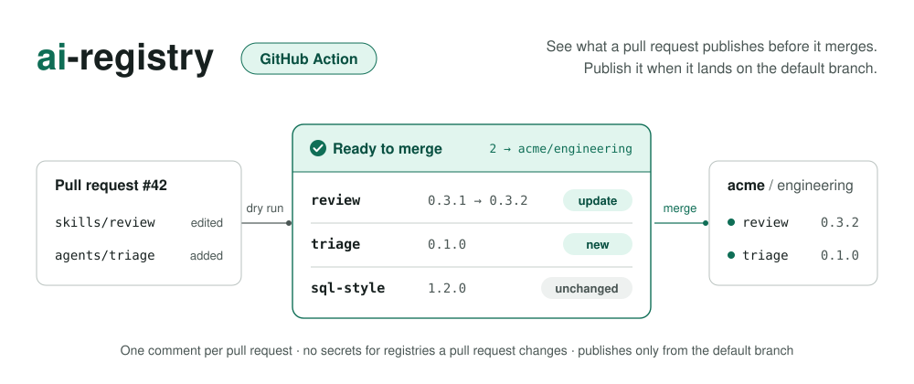

<p align="center">
  
</p>

<p align="center">
  <a href="https://github.com/atlanai/ai-registry-action/actions/workflows/ci.yml"></a>
  <a href="https://github.com/atlanai/ai-registry-action/releases"></a>
  <a href="LICENSE"></a>
</p>

Preview every change to your skills and agents on the pull request, and publish them to your registry when it merges.

[ai-registry](https://github.com/atlanai/ai-registry) · [Manifest reference](https://atlanai.github.io/ai-registry/reference/publish/) · [Security](SECURITY.md)

## Usage

```yaml
on:
  pull_request:
  push:
    branches: [main]

jobs:
  aireg:
    runs-on: ubuntu-latest
    permissions:
      contents: read
      pull-requests: write
    steps:
      - uses: actions/checkout@v7
      - uses: atlanai/ai-registry-action@v1
        env:
          AIREG_TOKEN_ACME: ${{ secrets.AIREG_TOKEN_ACME }}
```

On a pull request, the action comments with what merging would publish. On `main`, it publishes. It reads your [`.registry/manifest.yml`](https://atlanai.github.io/ai-registry/reference/publish/), the same file `aireg publish` uses locally.

[`examples/publish.yml`](examples/publish.yml) is a hardened version with pinned actions and a protected environment for the publish token.

### With options

```yaml
- uses: atlanai/ai-registry-action@v1
  with:
    working-directory: platform/agents   # folder with .registry/manifest.yml
    publish: false                       # always preview, never publish
    fail-on-conflict: false              # report conflicts without failing
```

### Credentials

Each registry reads its token from `AIREG_TOKEN_<ALIAS>`, the registry's alias in capitals with other characters replaced by `_`: `acme` becomes `AIREG_TOKEN_ACME`, `prod.eu` becomes `AIREG_TOKEN_PROD_EU`. Registries that need no credential need no secret.

## Inputs

| Name | Default | Description |
| --- | --- | --- |
| `working-directory` | `.` | Folder with `.registry/manifest.yml`. |
| `publish` | `auto` | `auto` publishes on push and previews pull requests. `true` publishes, `false` previews. |
| `comment-on-pr` | `true` | Comment the preview on the pull request. |
| `fail-on-conflict` | `true` | Fail when the registry changed an artifact this pull request also changes. |
| `github-token` | `github.token` | Token used to comment. |

Runs on Linux and macOS, for repositories on github.com. Publishing only happens on the default branch.

## License

[Apache 2.0](LICENSE)
